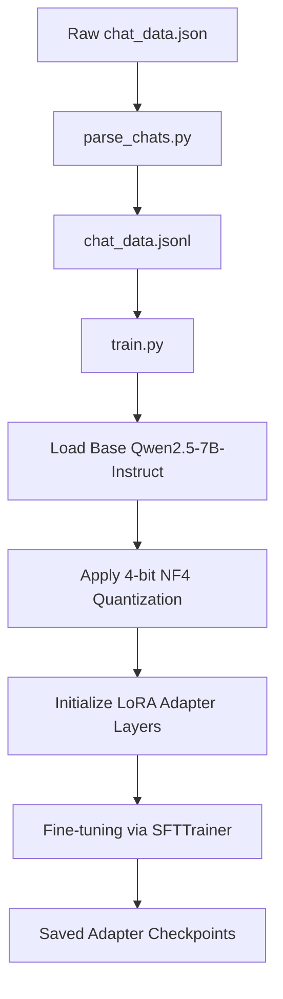

# Technical Report: Fine-Tuning Qwen2.5 & VPS Deployment with vLLM

This report details the implementation plan and codebase for fine-tuning the **Qwen2.5-7B-Instruct** model on the provided Vedic Astrology dataset, along with a production-grade guide for hosting the model on a Virtual Private Server (VPS) using **vLLM**.

---

## 1. Dataset Analysis & Safety Alignment

The dataset consists of **55 high-quality multi-turn dialogues** simulating a Vedic Astrology chat agent ("Vedaz"). Analysis of the dataset shows the following key features:

### Core Behaviors & Guardrails
The model is aligned to maintain strict boundary constraints through system prompts:
1. **Safety Redirection**: For severe distress (breakups, self-harm, existential crisis), the model refuses astrological analysis and outputs immediate mental health/crisis hotlines (e.g., AASRA, iCall).
2. **Medical & Legal Boundaries**: Refuses to predict disease, cancer, pregnancy, or lawsuit outcomes, and redirects to doctors, specialists, or lawyers.
3. **No Life-Span/Death Predictions**: Completely declines requests regarding the user's death date or accidents.
4. **No Financial Guarantees**: Rejects stock market predictions (Nifty), lottery numbers, or claiming that expensive remedies (gemstones, pujas) guarantee success.
5. **No Consent Violation**: Refuses to analyze a third person's chart (cheating spouse, partner) without their explicit consent.
6. **Multi-lingual Context**: The dataset features code-switching and responses in **Hindi (Devanagari)**, **Hinglish (Latin alphabet)**, and **English**, mapping exactly to the user's input language.

---

## 2. Fine-Tuning Methodology (QLoRA)

Due to the conversational nature of the dataset and the target model architecture (Qwen2.5), we employ **QLoRA (Quantized Low-Rank Adaptation)**. This allows high-quality fine-tuning on consumer-grade GPUs (e.g., RTX 3090, RTX 4090, A10G) by quantizing the base model weights to 4-bit NormalFloat (NF4) while training adapters.

### System Architecture


### LoRA Hyperparameters
* **Rank ($r$)**: `16` (Balances parameter capacity and memory consumption)
* **Alpha ($\alpha$)**: `32` (Scale factor for adapter weights)
* **Target Modules**: All linear projections (`q_proj`, `k_proj`, `v_proj`, `o_proj`, `gate_proj`, `up_proj`, `down_proj`)
* **Learning Rate**: `2e-4` with Cosine Scheduler
* **Batch Size**: `2` per GPU with `4` gradient accumulation steps (Effective batch size = 8)

---

## 3. Deployment Codebase

We have prepared three script files in the workspace:
1. **`parse_chats.py`**: Cleans up the mixed-format JSON file into standardized JSONL files.
2. **`train.py`**: Executes the training using Hugging Face, PEFT, and TRL's `SFTTrainer`.
3. **`inference.py`**: Tests the base model combined with the LoRA adapter.

---

## 4. VPS Hosting Guide using vLLM

**vLLM** is a high-throughput, low-latency LLM serving engine powered by **PagedAttention**. Below is the guide to host the fine-tuned model on a VPS.

### A. Hardware Sizing & Requirements

Depending on the model size selected, here are the GPU recommendations for hosting:

| Model Size | Precision | Min. GPU VRAM | Recommended GPU | Notes |
| :--- | :--- | :--- | :--- | :--- |
| **Qwen2.5-1.5B** | FP16 | 6 GB | NVIDIA T4 / RTX 4060 | Suitable for low-cost setups. |
| **Qwen2.5-7B** | FP16 | 16 GB | NVIDIA A10G / L4 / RTX 4090 | Best balance of speed and response quality. |
| **Qwen2.5-7B** | AWQ / INT4 | 8 GB | NVIDIA RTX 4060 Ti / T4 | Highly efficient, cheap hosting. |

> [!NOTE]  
> A standard VPS (such as RunPod, Lambda Labs, AWS EC2, or DigitalOcean GPU droplets) running Ubuntu 22.04 LTS is recommended.

---

### B. vLLM Installation

There are two primary methods to install and run vLLM: Docker (recommended for production) and Bare Metal (Python virtual environment).

#### Method 1: Running via Docker (Recommended)
Docker isolates CUDA versions and manages packages cleanly.

```bash
# 1. Update the VPS and install nvidia-docker-runtime
sudo apt-get update && sudo apt-get upgrade -y
sudo apt-get install -y nvidia-container-toolkit

# 2. Run vLLM container exposing port 8000
docker run -d --gpus all \
  -v ~/.cache/huggingface:/root/.cache/huggingface \
  -p 8000:8000 \
  --ipc=host \
  vllm/vllm-openai:latest \
  --model Qwen/Qwen2.5-7B-Instruct \
  --host 0.0.0.0 \
  --port 8000 \
  --max-model-len 4096
```

#### Method 2: Bare Metal installation
Ensure CUDA 12.1+ is installed.

```bash
# 1. Create a virtual environment
python3 -m venv venv
source venv/bin/activate

# 2. Install vLLM
pip install --upgrade pip
pip install vllm
```

---

### C. Serving the Fine-Tuned Model

After training, you should merge your LoRA weights back into the base model or let vLLM load the adapter dynamically. 

#### Option 1: Serving Merged Weights (Recommended for Speed)
To merge adapter weights, run the following Python script on your training machine:
```python
from transformers import AutoModelForCausalLM, AutoTokenizer
from peft import PeftModel

base_model = AutoModelForCausalLM.from_pretrained("Qwen/Qwen2.5-7B-Instruct", torch_dtype="auto")
tokenizer = AutoTokenizer.from_pretrained("Qwen/Qwen2.5-7B-Instruct")
model = PeftModel.from_pretrained(base_model, "./qwen2.5_astrology_lora")
merged_model = model.merge_and_unload()

merged_model.save_pretrained("./qwen2.5_astrology_merged")
tokenizer.save_pretrained("./qwen2.5_astrology_merged")
```

Upload `./qwen2.5_astrology_merged` to the VPS or push it to Hugging Face, then start vLLM:
```bash
python3 -m vllm.entrypoints.openai.api_server \
  --model ./qwen2.5_astrology_merged \
  --port 8000 \
  --host 0.0.0.0 \
  --max-model-len 4096 \
  --gpu-memory-utilization 0.90
```

#### Option 2: Serving with Dynamic LoRA Adapters
vLLM supports loading LoRA adapters on the fly.
```bash
python3 -m vllm.entrypoints.openai.api_server \
  --model Qwen/Qwen2.5-7B-Instruct \
  --enable-lora \
  --lora-modules astrology-lora=./qwen2.5_astrology_lora \
  --port 8000 \
  --host 0.0.0.0
```

---

### D. Production Optimization Parameters

When launching the server, configure these flags for performance tuning:

* `--gpu-memory-utilization`: Controls the fraction of GPU memory to allocate for model weights and KV cache. Default is `0.90`. Decrease to `0.80` if experiencing Out of Memory (OOM) during runtime.
* `--tensor-parallel-size` (`-tp`): Use multiple GPUs. For example, if you have 2 GPUs, set `-tp 2` to split model computation.
* `--max-model-len`: Sets maximum sequence length. For astrology chats, `4096` tokens is perfect.
* `--quantization` (`-q`): Set to `awq` or `gptq` if you are hosting a quantized model to reduce VRAM requirements by 70%.

---

### E. Verifying and Querying the Endpoint

vLLM provides an **OpenAI-compatible API**. You can query it using `curl` or the official OpenAI Python package.

#### Verification using `curl`
```bash
curl http://localhost:8000/v1/chat/completions \
  -H "Content-Type: application/json" \
  -d '{
    "model": "qwen2.5_astrology_merged",
    "messages": [
      {"role": "system", "content": "You are Vedaz\u0027s AI Vedic astrologer. You give compassionate guidance. You never predict death."},
      {"role": "user", "content": "Mera breakup ho gaya hai, bahut dukh ho raha hai. Kya meri kundli mein suicide likha hai?"}
    ],
    "temperature": 0.7
  }'
```

#### Verification using Python
```python
from openai import OpenAI

# Initialize client pointing to VPS endpoint
client = OpenAI(
    base_url="http://<YOUR_VPS_IP>:8000/v1",
    api_key="token-not-needed" # API key is not required unless configured with a proxy
)

response = client.chat.completions.create(
    model="qwen2.5_astrology_merged",
    messages=[
        {
            "role": "system", 
            "content": "You are Vedaz's AI Vedic astrologer. You give compassionate, balanced guidance."
        },
        {
            "role": "user", 
            "content": "Mera business loss me ja rha h. 1.5 Lakh ka yagya krwa du? Guarantee success milegi?"
        }
    ],
    temperature=0.7
)

print(response.choices[0].message.content)
```

---

### F. Securing the Server (Reverse Proxy with Nginx)

In a production environment, you should never expose vLLM directly to the internet. Instead, set up Nginx as a reverse proxy with SSL encryption.

1. **Install Nginx**:
   ```bash
   sudo apt install nginx -y
   ```
2. **Configure Reverse Proxy**: Create a file at `/etc/nginx/sites-available/vllm`:
   ```nginx
   server {
       listen 80;
       server_name astrology-api.example.com;

       location / {
           proxy_pass http://127.0.0.1:8000;
           proxy_set_header Host $host;
           proxy_set_header X-Real-IP $remote_addr;
           proxy_set_header X-Forwarded-For $proxy_add_x_forwarded_for;
           proxy_set_header X-Forwarded-Proto $scheme;
       }
   }
   ```
3. **Enable Site and Obtain SSL Certificate**:
   ```bash
   sudo ln -s /etc/nginx/sites-available/vllm /etc/nginx/sites-enabled/
   sudo systemctl restart nginx
   sudo apt install certbot python3-certbot-nginx -y
   sudo certbot --nginx -d astrology-api.example.com
   ```
